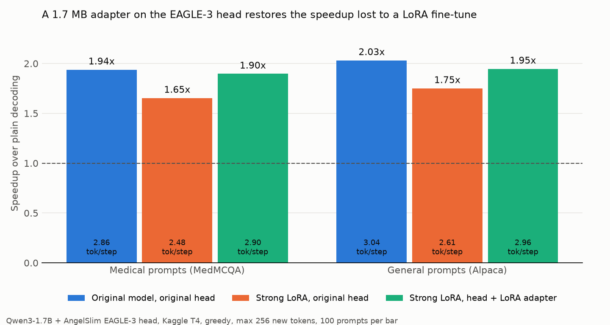

# drafter-lora

**When you LoRA fine-tune a model, its EAGLE-3 speculative-decoding head loses accuracy, and the speedup shrinks. A 1.7 MB LoRA adapter on the draft head wins most of it back.**

A small proof of concept on Qwen3-1.7B, run on a free Kaggle T4. Every number below comes from a logged run. The raw per-prompt CSVs and run logs are in [`results/`](results/).



## Results

| | Medical prompts | General prompts |
|---|---|---|
| Original model, original head | 2.86 tok/step, **1.94×** | 3.04 tok/step, **2.03×** |
| Strong LoRA fine-tune, original head | 2.48 tok/step, **1.65×** | 2.61 tok/step, **1.75×** |
| Strong LoRA fine-tune, head + 1.7 MB adapter | 2.90 tok/step, **1.90×** | 2.96 tok/step, **1.95×** |

*tok/step = tokens produced per step: accepted draft tokens plus the one token the target adds itself. The speedup is tokens/s with the draft head ÷ tokens/s with plain decoding, both measured in the same session on the same 100 prompts. Medical = 100 held-out MedMCQA questions. General = 100 Alpaca instructions.*

- **Fine-tuning hurts the head.** The strong fine-tune lowers tokens per step by 14% on both prompt sets, and the speedup drops by about 0.3×.
- **The adapter fixes it.** On medical prompts (the adapter's training domain), tokens per step are back to the original model's level. The adapter recovers 86% of the lost speedup.
- **It also helps outside its domain.** The adapter saw only medical text, yet on general prompts it recovers 70% of the lost speedup. Prompt by prompt, it raised tokens per step on 82 of 98 prompts and lowered it on 3.
- **It is tiny:** 851,968 parameters and 1.7 MB, against 136.8M parameters and 274 MB for the full head (0.62%).
- **Light fine-tunes don't matter.** A mild LoRA (1,000 examples, 1 epoch, rank 16) changed the model's answer style completely, yet tokens per step didn't drop. The drop appeared only with heavier fine-tunes.

### Paired comparisons (same prompts, before vs after)

Accepted tokens per step, compared prompt by prompt. Prompts where either run's output loops are excluded. The 95% intervals are bootstrapped over prompts ([`paired.py`](paired.py), [`results/paired_stats.csv`](results/paired_stats.csv)).

| Comparison | Prompts | Mean change | 95% interval | After higher / lower |
|---|---|---|---|---|
| Medical: mild LoRA vs original | 93 | +0.06 (+2.1%) | −0.06 to +0.18 | 42 / 51 |
| Medical: medium LoRA vs original | 96 | −0.36 (−12.5%) | −0.47 to −0.24 | 19 / 77 |
| Medical: strong LoRA vs original | 99 | −0.41 (−14.1%) | −0.51 to −0.30 | 15 / 84 |
| **Medical: adapter vs no adapter** (strong LoRA) | 99 | **+0.47 (+19.2%)** | +0.41 to +0.54 | 95 / 2 |
| Medical: adapter vs original model | 99 | +0.07 (+2.3%) | −0.05 to +0.19 | 46 / 52 |
| General: strong LoRA vs original | 98 | −0.44 (−14.2%) | −0.55 to −0.32 | 16 / 82 |
| **General: adapter vs no adapter** (strong LoRA) | 98 | **+0.32 (+12.1%)** | +0.26 to +0.38 | 82 / 3 |
| General: adapter vs original model | 99 | −0.11 (−3.5%) | −0.21 to +0.01 | 37 / 62 |

### How hard must you fine-tune before the head falls behind?

Three LoRA fine-tunes of the target on MedMCQA, each scored with the **original** head on the same 100 held-out medical questions:

| Fine-tune | Training | Trainable params | Tok/step (no loops) | Speedup | Looping outputs |
|---|---|---|---|---|---|
| None | – | – | 2.86 | 1.94× | 0% |
| Mild | 1,000 examples × 1 epoch, rank 16, lr 1e-4 | 17.4M (1.0%) | 2.88 | 2.04× | 7% |
| Medium | 2,000 × 3 epochs, rank 64, lr 1e-4 | 69.7M (3.9%) | 2.47 | 1.72× | 4% |
| Strong | 2,000 × 3 epochs, rank 64, lr 3e-4 | 69.7M (3.9%) | 2.45 | 1.65× | 1% |

All three fine-tunes changed the output a lot. Every answer switched to the trained "Answer: X. … / Explanation: …" format, and typical answers shrank from 224 to 43–65 tokens. So a visible change in style doesn't predict whether the head falls behind. I also tried measuring how far each model drifted: the share of its output tokens that the original model would also have chosen greedily ([`shift.py`](shift.py)). It came out at 99.8% for the original model, 73.1% for mild, 72.5% for medium and 67.6% for strong. It doesn't separate mild from medium, so it's reported here but not relied on.

The mild fine-tune's speedup row comes from a different Kaggle session than the medium and strong rows. Raw speeds vary by about 10% between sessions, so compare tokens per step across sessions, and speedups only within a session. Tokens per step reproduced exactly across sessions: 2.861 for the original model on medical prompts in three sessions, and 3.035 on general prompts in two.

## Setup

| | |
|---|---|
| Target | [Qwen/Qwen3-1.7B](https://huggingface.co/Qwen/Qwen3-1.7B), fp16, thinking disabled |
| Draft head | [AngelSlim/Qwen3-1.7B_eagle3](https://huggingface.co/AngelSlim/Qwen3-1.7B_eagle3) (1 decoder layer, 32k draft vocab, 274 MB) |
| Speculative decoding | Official [SafeAILab/EAGLE](https://github.com/SafeAILab/EAGLE) code, commit `cb7e084`; `total_token=60, depth=7, top_k=10` |
| Decoding | Greedy, max 256 new tokens, batch size 1 |
| Hardware | Kaggle, one NVIDIA T4 (16 GB); torch 2.11, transformers 4.53.3, peft 0.16.0 |
| Domain data | [MedMCQA](https://huggingface.co/datasets/openlifescienceai/medmcqa): train split for fine-tuning and head data, validation split for evaluation |
| General prompts | 100 [Alpaca](https://huggingface.co/datasets/tatsu-lab/alpaca) instructions with no input field |
| Seeds | 42 everywhere (bootstrap: 0) |

## Method

1. **Baseline** ([`bench.py`](bench.py)). For each prompt, run EAGLE-3 speculative decoding (`eagenerate`) and plain decoding (`naivegenerate`) on the same model, after one warm-up. Record new tokens, draft/verify steps and wall time, with CUDA synchronisation around each run.
2. **Fine-tune the target** ([`train_target_lora.py`](train_target_lora.py)). LoRA on all attention and MLP projections. Base weights in fp16, adapter weights in fp32, loss on the answer tokens only. The LoRA is merged into the weights, because EAGLE loads the target from a folder.
3. **Generate head-training data** ([`gen_head_data.py`](gen_head_data.py)). The fine-tuned target answers 600 MedMCQA training questions that don't overlap its own 2,000 training questions (checked: overlap 0). Greedy speculative decoding is verified by the target, so these are the target's own greedy answers.
4. **Train the head adapter** ([`train_head_lora.py`](train_head_lora.py), [`head_lora.py`](head_lora.py)). LoRA with rank 16 on every linear layer of the head except its output layer (`q/k/v/o_proj`, `gate/up/down_proj`, and `fc`, which projects the target's three hidden-state taps). All head weights are frozen. For each sequence, the fine-tuned target's hidden states (the inputs to layers 2, 14 and 25, which is where EAGLE taps them) and logits are computed on the fly. The head is trained to match the target's next-token distribution over the draft vocabulary, using the same soft cross-entropy as EAGLE-3's training code. 540 sequences for training, 60 held out, 2 epochs, lr 2e-4. On the held-out answers, the head's top-1 agreement with the target went from 51.7% to 66.0%.
5. **Evaluate.** The adapter is merged into the head's weights, then `bench.py` is run again. The original model, the broken setup and the fixed setup are all benchmarked in one session.

## Limitations

- **One model, one domain, one seed.** No repeat runs with different seeds; the intervals above cover prompt-to-prompt variation only.
- **Only the head's first draft step is trained.** EAGLE-3's own recipe also unrolls later draft steps ("training-time test"). That wasn't needed to recover the drop here, but it might be for larger shifts.
- **Kaggle's T4 isn't a serving GPU.** Absolute tokens/s are low and vary by about 10% between sessions. Relative results within a session are the meaningful ones.
- **fp16 output differences.** Speculative decoding is lossless in exact arithmetic, but in fp16 the text matched plain greedy decoding on only 73–97% of prompts, depending on the run (`same_output_pct` in [`results/summary_all.csv`](results/summary_all.csv)). Batched verification rounds differently and can flip near-tied tokens.
- **Looping outputs.** A few fine-tuned outputs repeat themselves until the token limit. A looping output is one where at least 30% of its 8-word chunks are repeats ([`summarize.py`](summarize.py)). Repetition is easy to predict and inflates tokens per step, so the comparisons above exclude looping prompts and the tables report both versions.
- **The adapter was trained and tested on the same kind of question** (held-out MedMCQA). The general-prompt check shows it helps outside that domain, but recovery there is partial.

## What went wrong along the way

- **The first Stage 2 fine-tune "improved" acceptance, from 2.86 to 3.57.** That fine-tune used raw MedMCQA explanations and lr 2e-4. 28 of its 100 answers were flagged as looping (41 ran all the way to the token limit), and repeated text is trivially easy to draft. The fix was a cleaner training set: explanations without "Ans. is 'a' i.e." prefixes, textbook citations or run-together sentences, which kept 25,751 of the 106,370 single-answer training questions that have an explanation. I also halved the learning rate and added the looping check to every summary. The log is kept in [`results/logs/stage2_attempt1_looping_lora.txt`](results/logs/stage2_attempt1_looping_lora.txt) and the CSVs as `*_v1.csv`.
- **The first Kaggle run got no GPU and no internet**, because the account wasn't phone-verified. Kaggle doesn't report this as an error ([`results/logs/stage1_attempt1_no_gpu.txt`](results/logs/stage1_attempt1_no_gpu.txt)).
- **After the mild fine-tune, tokens per step didn't drop at all.** The project's premise didn't hold at that strength. Stage 2b measures how much fine-tuning it takes before the drop appears.

## Reproduce

### Option A: run interactively in a Kaggle notebook
1. In Kaggle, use **File → Import Notebook** to import [`drafter_lora_kaggle.ipynb`](drafter_lora_kaggle.ipynb). Set **Accelerator → GPU T4** and turn **Internet** on. GPU and internet need a phone-verified account.
2. Run **Setup** and the `%%writefile` cells, then each stage's cells in order: 1, 2, 2b, 3, 3b, 4. Every stage starts with a small smoke run. Every script is resumable and skips work whose output already exists.

### Option B: unattended runs with the Kaggle CLI
```bash
pip install kaggle                         # then save an API token from kaggle.com → Settings → API
python build_notebook.py --stages 1 --out kaggle/stage1/stage1.ipynb
# set "id" in kaggle/stage1/kernel-metadata.json to <your-username>/drafter-lora-stage1
kaggle kernels push -p kaggle/stage1 --accelerator NvidiaTeslaT4
kaggle kernels status <your-username>/drafter-lora-stage1
kaggle kernels output <your-username>/drafter-lora-stage1 -p out
```
Repeat for `2`, `2b`, `3` and `3b`. Each stage reads the previous stages' outputs through `kernel_sources` in its metadata: 2 ← 1, 2b ← 1 + 2, 3 ← 2b, 3b ← 2b + 3. Update those ids to your username too.

### Rebuild the tables and chart from the CSVs (no GPU)
```bash
pip install matplotlib
python summarize.py --out results/summary_all.csv "S3 original, medical=results/stage3_med_original.csv" "S3 strong LoRA, orig head, medical=results/stage3_med_strong_orighead.csv" "S3 strong LoRA, head+adapter, medical=results/stage3_med_strong_fixed.csv"   # add any other runs as label=csv
python paired.py --out results/paired_stats.csv "medical: adapter vs no adapter=results/stage3_med_strong_orighead.csv,results/stage3_med_strong_fixed.csv"
python plot.py --medical results/summary.csv --general results/summary_stage3b.csv --out results/chart.png
```
`summarize.py` and `paired.py` only need the Python standard library.

## Files

| Path | What it is |
|---|---|
| `common.py` | Model ids, seeds, prompt formatting, EAGLE model loader |
| `make_prompts.py` | Builds the fixed prompt sets and training data |
| `check_head.py` | Smoke test: head weights match the model; EAGLE output equals plain decoding |
| `bench.py` | Speculative vs plain decoding, one CSV row per prompt |
| `train_target_lora.py` | LoRA fine-tune of the target, then merge |
| `gen_head_data.py` | Generates head-training data with the fine-tuned target |
| `head_lora.py`, `train_head_lora.py` | Head adapter: add, train, save, load and merge |
| `summarize.py`, `paired.py`, `shift.py`, `plot.py` | Tables, paired statistics, drift measure, chart |
| `build_notebook.py` | Packs the scripts into the Kaggle notebook(s) |
| `adapters/head_lora/` | The trained 1.7 MB head adapter |
| `results/` | Per-prompt CSVs for every run, summaries, training logs, run logs |

## Credits

Built on [EAGLE](https://github.com/SafeAILab/EAGLE) (Li et al.), [Qwen3](https://huggingface.co/Qwen/Qwen3-1.7B), the [AngelSlim](https://huggingface.co/AngelSlim) EAGLE-3 head, [MedMCQA](https://huggingface.co/datasets/openlifescienceai/medmcqa), [Alpaca](https://huggingface.co/datasets/tatsu-lab/alpaca) and [PEFT](https://github.com/huggingface/peft). Check each source's license before reusing its weights or data.
